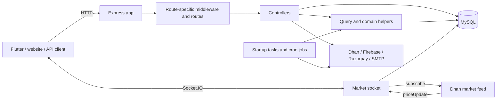

# Backend architecture

This guide describes the code in this repository, not a prescribed architecture.
Investapas is an Express backend for trading-related features, including Dhan
broker access, simulated trading, challenges, payments and website accounts.
It also serves static pages and forwards market prices over Socket.IO. Start
with [app.js](app.js), then follow a request through a route and its controller.



## Starting up and handling a request

1. `npm start` or `npm run dev` runs [bin/www](bin/www), which imports
   [app.js](app.js), sets `PORT` (default `3000`) and listens on the HTTP
   server exported by the app. The dev script uses nodemon to restart on changes.
2. `app.js` loads `.env` from the working directory, creates Express and an
   HTTP server, attaches Socket.IO and calls [config/socket.js](config/socket.js).
   It also registers cron jobs and a delayed startup instrument/expiry sync.
3. For HTTP, Morgan logs requests except in `NODE_ENV=test`. Middleware attaches
   `req.io`, parses JSON and URL-encoded bodies, parses cookies, serves static
   files and enables CORS. JSON parsing preserves `req.rawBody` for the
   Razorpay webhook signature. Static files can finish a request before routes
   are reached. `/test` returns a simple health response.
4. The path selects a mounted module, such as `/demo` or `/account`. Many
   individual routes run [middlewares/api.js](middlewares/api.js) to populate
   `req.locals` and initialize MySQL pools if necessary, then optionally run
   [authentication middleware](middlewares/authentication.js). This is
   **route-specific**, not a universal authentication layer: for example,
   [contact routes](routes/contact.js) are public.
5. A controller validates input, performs business logic and calls helpers,
   SQL or external services. Many responses use [vars/apiResponse.js](vars/apiResponse.js)
   (`status`, `message`, optionally `data`), but not every endpoint uses the
   same shape. Unmatched requests get a JSON 404. Controllers often handle
   their own errors; do not assume one uniform error handling strategy.

Importing `app.js` has side effects: Socket.IO setup, cron registration and
the delayed sync. Jobs include instrument and candle updates, trade and demo
P&L sync, challenge resets, expiry sweeps, notifications and trade-history
sync. See [app.js](app.js) for schedules and time zones; some explicitly use
`Asia/Kolkata`, while the frequent sync jobs do not specify a timezone.
**Use isolated test data and sandbox credentials:** running the server can call
external APIs, update database records or send notifications without an HTTP
request. Real Dhan orders can affect a live brokerage account.

## Where to look

| Path | Responsibility |
| --- | --- |
| [package.json](package.json), [bin/www](bin/www), [app.js](app.js) | Dependencies, entry point, middleware, route mounts, socket server and scheduled jobs. |
| [routes/](routes/) | URL-to-handler mapping. Modules use Express routers or small Express apps; route middleware is explicit. |
| [controllers/](controllers/) | Request validation, orchestration, business logic and responses. Examples: [DhanController.js](controllers/DhanController.js), [DemoController.js](controllers/DemoController.js), [AccountController.js](controllers/AccountController.js). |
| [middlewares/](middlewares/) | Request context/database initialization and token checks. |
| [helpers/](helpers/) | Shared SQL helpers and domain logic, including challenge rules, trade synchronization, candle caches, notifications and the Dhan feed. There is no separate, consistent `services/` layer; controllers and helpers both access SQL and integrations. Some routes, such as [trading.js](routes/trading.js), contain handlers directly. |
| [config/](config/) and [vars/](vars/) | MySQL pool and socket setup; shared database configuration, mutable connection state, constants and response helpers. |
| [database/](database/) and [migrations/](migrations/) | MySQL schema/data dumps and numbered SQL changes. Check the target database state before applying migrations; the repository does not document an automatic migration runner. |
| [models/mongo/](models/mongo/) and [vars/models/mongo/](vars/models/mongo/) | Mongoose schema/model definitions from the inactive MongoDB path, not the primary SQL data layer. |
| [public/](public/), [Assets/](Assets/) | Static content, including the quiz page and evidence assets. `app.js` also exposes paths for profile pictures, notification images and uploads. |
| [data/](data/), [scripts/](scripts/), [postman/](postman/) | Quiz seed data, a seed script and a contact API collection. |

Major route groups are mounted in [app.js](app.js): `/dhan`, `/demo`,
`/challenge`, `/trial`, `/wishlist`, `/profile`, `/wallet`, `/payment`,
`/admin`, `/notification`, `/api/trading`, `/contact`, `/account` and
`/api/quiz`. Consult each route file for HTTP methods, parameters and whether
authentication is required; some Dhan routes use `app.use` rather than a
method-specific route.

## Persistence and configuration

**MySQL is the active database.** [vars/db.js](vars/db.js) maps the logical
`mysql_bpr` connection to `project_investapas` on localhost;
[vars/constants.js](vars/constants.js) selects the default database.
[config/mysqlClient.js](config/mysqlClient.js) creates mysql2 read/write pools
and exposes `query`. Although it detects `SELECT`, it currently overrides the
choice to the write pool. Credentials and connection settings are in code,
not sourced from `.env` by this client; obtain the approved local settings
from the maintainers and **do not copy or reuse checked-in credential values**.
Never commit local secrets or real customer data.

Controllers use `dbcon.query` directly or the CRUD functions in
[helpers/query.js](helpers/query.js). The SQL dumps include tables such as
`users`, `user_challenges`, `demo_orders` and `website_contacts`. Some queries
use mysql2 placeholders, while helper functions also accept raw SQL condition
strings; do not assume all database access is parameterized. There is no
application-wide ORM/repository boundary.

**MongoDB is not connected by the current runtime path.** Mongoose is a
dependency and Mongo model files exist, but [config/mongoClient.js](config/mongoClient.js)
is commented out, as is the connection in [middlewares/api.js](middlewares/api.js).
Mongo-based request/query logging calls are also commented out. Installing
MongoDB alone does not enable them.

## Authentication and integrations

* **Dhan/app and admin:** [DhanController.js](controllers/DhanController.js)
  exchanges a consent token with Dhan, stores account details/access token in
  `users`, and issues an application JWT. The `authentication` middleware
  verifies JWTs with `JWT_SECRET`, accepts a `dhanClientId` or an `admin_Id`,
  and checks the stored token for admin tokens. The Authorization header
  accepts either a raw token or the standard bearer scheme.
* **Website:** [AccountController.js](controllers/AccountController.js)
  verifies a Firebase phone-OTP ID token, then issues a separate JWT with
  `type: "web"` and `userId`. `webAuthentication` accepts that token for
  website account routes; it is not the Dhan trading token. The code creates a
  separate Firebase app for website token verification.
* **Firebase:** [helpers/firebase.js](helpers/firebase.js) loads a local
  service-account JSON for the default Firebase Admin app; push notifications
  use this integration. The website verification app uses its own project ID.
* **Dhan:** [DhanController.js](controllers/DhanController.js) calls the broker
  for consent, orders and market data. [config/socket.js](config/socket.js)
  and [helpers/dhanMarketFeed.js](helpers/dhanMarketFeed.js) bridge its market
  feed to Socket.IO.
* **Razorpay:** [PaymentController.js](controllers/PaymentController.js),
  [WalletController.js](controllers/WalletController.js) and
  [TrialController.js](controllers/TrialController.js) implement payment,
  top-up and subscription flows. `/trial/razorpay-webhook` is public but checks
  a signature against the raw body rather than using an app JWT.
* **Email:** [ContactController.js](controllers/ContactController.js) and
  [EarlyAccessController.js](controllers/EarlyAccessController.js) use
  Nodemailer and SMTP settings. Email is conditional on configuration.

Cookie parsing is enabled, but these documented account sessions use JWTs in
the Authorization header, not an Express server-side session store. Auth
middleware is not automatically applied to every route; inspect the specific
route and controller for authorization checks.

## Trace these flows

### 1. Submit a contact form

`POST /contact/submit` → [routes/contact.js](routes/contact.js) runs API
middleware without token authentication → [ContactController.js](controllers/ContactController.js)
validates required fields and email, normalizes email/phone, and queries
`website_contacts` via [mysqlClient.js](config/mysqlClient.js). A duplicate
increments `contact_count` and returns a validation response; otherwise it
inserts a row, starts a confirmation email without waiting for it, and returns
the new ID through [apiResponse.js](vars/apiResponse.js).

### 2. Create and use a website account

`POST /account/signup` → [routes/account.js](routes/account.js) runs API
middleware → [AccountController.js](controllers/AccountController.js)
validates the form and verifies the Firebase phone ID token, checks/inserts the
`users` row in MySQL, and returns a web JWT and next step. A subsequent
`GET /account/me` runs `webAuthentication`, which verifies that JWT and sets
`req.webUser`; the controller loads the user and related state from MySQL.
This website flow is distinct from the Dhan app consent flow.

### 3. Stream a market price

At startup [config/socket.js](config/socket.js) looks up a market client ID
and token (MySQL `market_data_tokens`, with an environment fallback). With
credentials it starts [dhanMarketFeed.js](helpers/dhanMarketFeed.js); without
them the feed is not started. A Socket.IO client emits `subscribeMarket` with
instruments, joins the `market` room, and the server filters subscriptions
through [instrumentStatus.js](helpers/instrumentStatus.js). Feed `price` events
are emitted to that room as `priceUpdate`; `unsubscribeMarket` leaves the room.

## Install, run and test

Prerequisites: Node.js and npm, a MySQL server/client, and credentials for the
features being exercised. No Node version is pinned in [package.json](package.json);
ask the maintainers which version they use. There is no build script.

1. In a checkout of this repository, run `npm install`. The [README](README.md)
   uses `npm run dev`; `npm start` runs without nodemon.
2. Create a local `.env` with approved values. `app.js` loads `.env`, **not**
   [env.env](env.env). The README asks to copy `.env.example`, but that file
   is absent in this checkout; request the current template and secrets from
   maintainers. Key names used in code include `PORT`, `JWT_SECRET`,
   `JWT_EXPIRES_IN`, `DHAN_PARTNER_ID`, `DHAN_PARTNER_SECRET`,
   `DHAN_MARKET_CLIENT_ID`, `DHAN_MARKET_ACCESS_TOKEN`, `WEB_FIREBASE_PROJECT_ID`,
   `RAZORPAY_KEY_ID`, `RAZORPAY_KEY_SECRET`, `RAZORPAY_WEBHOOK_SECRET` and
   `SMTP_*`; which are needed depends on the feature.
3. Obtain `helpers/firebase_admin_sdk.json` securely and place it at that path.
   It is ignored by Git and absent from the checkout. The Firebase helper
   requires it when loaded, so its absence can prevent application startup,
   not merely website login.
4. Configure local MySQL access according to [vars/db.js](vars/db.js) and
   [config/mysqlClient.js](config/mysqlClient.js). The README gives:

   ```sh
   mysql -u root -p -e "CREATE DATABASE project_investapas"
   mysql -u root -p project_investapas < database/schema.sql
   mysql -u root -p project_investapas < database/data.sql
   ```

   Unlike the README's statement that data must be obtained separately,
   [database/data.sql](database/data.sql) is present in this checkout and is a
   large dump. Confirm its provenance, suitability and permission to use it;
   prefer an approved sanitized local dataset. Check schema/migration state with
   maintainers before importing or applying changes; do not blindly import
   into an existing database.
5. Start with `npm run dev` and check `http://localhost:3000/test`. This
   endpoint alone does not verify database connectivity or integrations.

`npm test` and `npm run lint` are declared in [package.json](package.json), but
the checkout does not declare `nyc`, Mocha or ESLint as dependencies, and the
referenced `.eslintrc.json` is absent. No conventional automated test suite is
visible; [dhanFeedTest.js](dhanFeedTest.js) is a standalone feed exercise that
needs Dhan credentials. Ask maintainers for the intended test environment.
The lint command uses `--fix`, so it can modify files. The existing
[QUICK_REFERENCE.md](QUICK_REFERENCE.md) provides more feature context, but
verify details against current code.

## Flutter client

The separately checked [Flutter API helper](https://github.com/investapas/investpas_app/blob/ea7169cbf3ad88bf43bc0e98ec950f872b70b8ce/lib/core/network/api_service.dart)
uses `https://api.investapas.in`, JSON HTTP requests and a stored authorization
token. The backend and app can run independently: without a local backend the
app uses its configured server. To connect a local app, change the client
configuration in its own checkout: `localhost:3000` for a desktop client,
`10.0.2.2:3000` for the standard Android emulator, or the backend machine's
reachable LAN address for a physical device. Device network/HTTP policies may
need adjustment. These are separate processes; opening both folders in one
workspace is optional.

## Suggested study order

1. **JavaScript fundamentals:** objects, destructuring, modules (`require` /
   `module.exports`), exceptions, callbacks, promises and `async`/`await`.
   Read [bin/www](bin/www) and a small controller.
2. **Node and HTTP:** npm scripts, environment variables, ports, request
   methods, headers, JSON and status codes. Try `/test`, then trace the contact
   flow above.
3. **Express:** middleware order, `next()`, router mounting, `req` and `res`.
   Compare [app.js](app.js), [routes/contact.js](routes/contact.js) and
   [middlewares/api.js](middlewares/api.js).
4. **SQL and persistence:** tables, indexes, CRUD, joins, placeholders and
   connection pools. Follow contact queries from controller to mysql2 and
   inspect [database/schema.sql](database/schema.sql).
5. **Authentication and security:** JWT signing/verification, Firebase ID
   tokens, authorization versus authentication, secrets and webhook HMACs.
   Compare the two token checks in [authentication.js](middlewares/authentication.js)
   and the webhook in [TrialController.js](controllers/TrialController.js).
6. **Architecture and asynchronous work:** follow controllers into query and
   domain helpers, then study cron, external HTTP calls, WebSockets/Socket.IO,
   and caching in [app.js](app.js) and [config/socket.js](config/socket.js).
   Finally trace a demo or Dhan order and its challenge rules; verify each
   branch in code rather than assuming real and demo trading behave identically.
